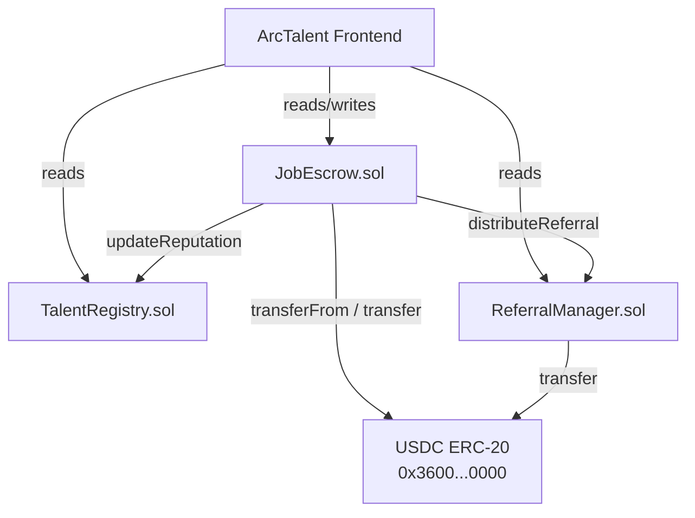
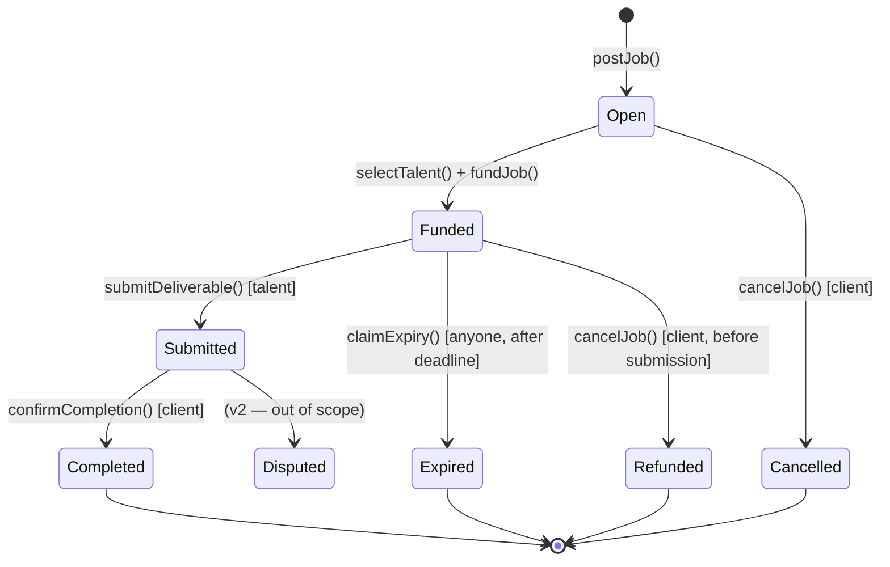
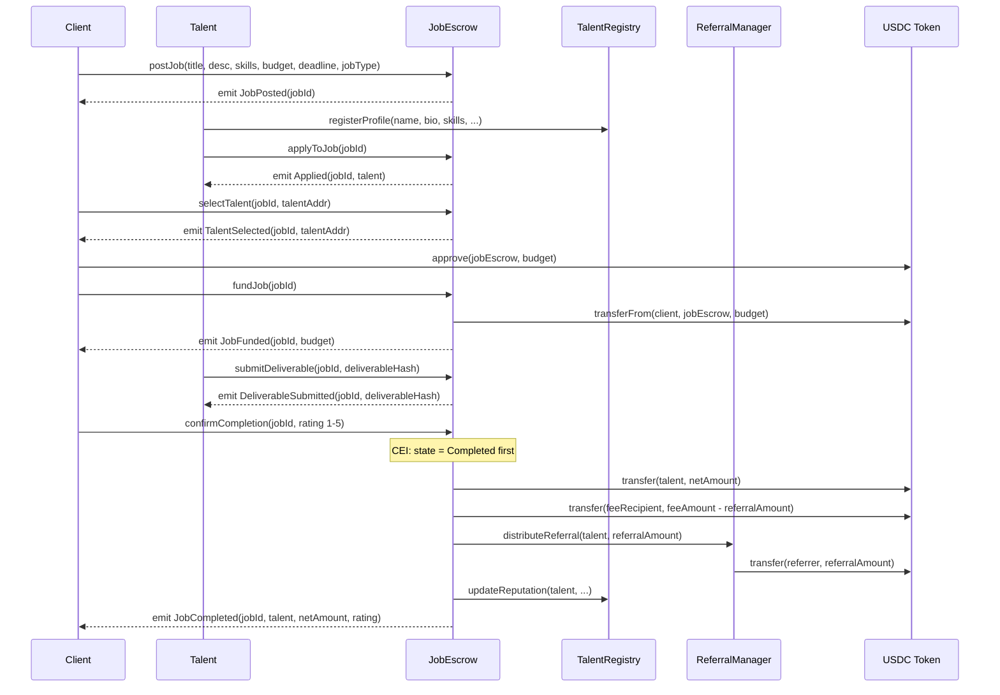

# ArcTalent Smart Contract Design Document

## 1. Metadata

| Field | Value |
|---|---|
| Status | Draft |
| Authors | Arc Studio |
| Target Chain(s) | Arc Testnet (chain ID 5042002) / Arc Mainnet (chain ID 5042) |
| Language / Toolchain | Solidity 0.8.28, Foundry, OpenZeppelin 5.6.1 |
| EVM Hardfork | Cancun |
| Milestone | v1 — testnet launch |

**Review Tracker**

- [ ] Design Review
- [ ] Security Review
- [ ] Ops Review

---

## 2. Action Items (living)

_Empty at draft. Fill after each review round._

---

## 3. Goals / Non-Goals

### Goals

- Allow clients to post jobs with a USDC budget, select a talent, and lock payment in escrow onchain.
- Allow talent to register profiles with skills and portfolio links, and apply to jobs.
- Enforce an unambiguous escrow state machine: `Open → Funded → Submitted → Completed | Refunded | Expired`.
- Calculate and store an onchain reputation score for each talent after job completion.
- Allow only clients who completed a job with a talent to rate that talent (1–5 stars).
- Distribute a 4% platform fee to a configurable fee recipient on successful job completion.
- Support an optional referral payout (1% of job budget from the platform fee slice) to a registered referrer on completion.
- Allow clients to generate referral links; a referred talent registers their referrer on signup.
- Support job cancellation (refund to client) before `Funded`, and expiry refund after the deadline if `Funded` but not yet `Submitted`.

### Non-Goals

- Multi-token escrow (USDC only — Arc's native token and the only payment asset).
- Dispute resolution / arbitration (out of scope for v1; planned for v2).
- Upgradeability via proxy (v1 is non-upgradeable; migration path documented in §13).
- Cross-chain jobs or bridging (Arc Testnet / Arc Mainnet only).
- Off-chain identity verification or KYC.
- Gas abstraction / meta-transactions (future via Circle Modular Wallets passkey flow in the frontend; contracts remain standard EOA-compatible).

---

## 4. Requirements

### Functional

- **F1** — A client wallet can call `postJob` to create a job with title, description, skills array, USDC budget, deadline (Unix timestamp), job type enum (`FIXED | BOUNTY | REFERRAL_ELIGIBLE`), and referral eligibility flag.
- **F2** — Any wallet can call `applyToJob(jobId)` to register as an applicant.
- **F3** — Only the job's client can call `selectTalent(jobId, talent)`, transitioning to `TALENT_SELECTED` sub-state.
- **F4** — Only the job's client can call `fundJob(jobId)`, pulling USDC from their wallet into the contract; state transitions to `Funded`.
- **F5** — Only the selected talent can call `submitDeliverable(jobId, deliverableHash)`, transitioning to `Submitted`.
- **F6** — Only the job's client can call `confirmCompletion(jobId, rating)`. On success: state → `Completed`; USDC net of fees released to talent; `TalentRegistry.updateReputation` called; referral payout dispatched via `ReferralManager`.
- **F7** — Client can call `cancelJob(jobId)` at any state before `Funded`; USDC refund issued if funds were deposited (none in `Open`).
- **F8** — Any caller can call `claimExpiry(jobId)` after the job's deadline if the state is still `Funded`; USDC refunded to client; state → `Expired`.
- **F9** — `TalentRegistry`: any wallet can `registerProfile` (idempotent upsert); anyone can read profile and reputation score.
- **F10** — `ReferralManager`: a talent can call `registerReferral(referrerCode)` once to link their address to a referrer; only `JobEscrow` can call `distributeReferral`.
- **F11** — Referral codes are deterministic: `keccak256(abi.encodePacked(referrerAddress))` truncated to bytes8, displayed as hex in the frontend. `ReferralManager.resolveCode(code)` returns the referrer address.

### Security

- **S1** — No path allows USDC to be withdrawn by anyone other than the rightful recipient (talent on completion, client on refund/cancel/expiry).
- **S2** — Platform fee is bounded: hard-coded maximum of 10%; current value readable; changeable only by owner.
- **S3** — Referral payout comes entirely from the platform fee slice, never from the talent's net amount.
- **S4** — Only `JobEscrow` can call `TalentRegistry.updateReputation` and `ReferralManager.distributeReferral`.
- **S4b** — `JobEscrow` address is set once in both `TalentRegistry` and `ReferralManager` constructors; it is updatable only by the contract owner (with a two-step ownership transfer).
- **S5** — Reentrancy is impossible on all fund-releasing functions via CEI ordering and `ReentrancyGuard`.
- **S6** — Only verified job completions (state == `Submitted`, caller == client) gate the rating write path.
- **S7** — A talent's referrer can be registered at most once per talent address.
- **S8** — Pausing (`Pausable`) halts all state-mutating functions in `JobEscrow`; read functions remain live.
- **S9** — No integer overflow/underflow (Solidity ≥0.8 checked arithmetic; no `unchecked` blocks on money paths).
- **S10** — `SafeERC20` used for all USDC transfers to handle any non-standard token edge cases, even though Arc USDC is well-behaved.

---

## 5. Terminology & Actors

| Term | Definition |
|---|---|
| Client | A wallet that posts a job and controls the escrow lifecycle |
| Talent | A wallet that registers a profile and applies to jobs |
| Referrer | A talent who referred another talent; earns a share of the platform fee on the referred talent's first completed job |
| Deliverable hash | A bytes32 or string submitted onchain by the talent pointing to off-chain work (IPFS hash, URL hash, or content hash) |
| Platform fee | 4% of job budget, sent to `feeRecipient` on completion |
| Referral payout | 1% of job budget (from within the platform fee slice) sent to the referrer on completion |
| Net talent payout | `budget × (1 - platformFeePct) + platformFeePct × referralPct` — simplifies to `budget × 96%` when no referral, `budget × 96% + 1% of budget to referrer` from the 4% |
| Reputation score | `(jobsCompleted × 10) + (avgRating × 20) + (totalUSDCEarned / 100)` — stored as uint256 in TalentRegistry |
| Referral code | `bytes8(keccak256(abi.encodePacked(address)))` — deterministic, no storage needed |

**Actors Table**

| Actor | On/Off-chain | Trust Level | What They Can Do |
|---|---|---|---|
| Client | On-chain EOA/contract | Semi-trusted | Post jobs, fund escrow, select talent, confirm completion, cancel jobs |
| Talent | On-chain EOA/contract | Semi-trusted | Register profile, apply to jobs, submit deliverables |
| Owner (deployer) | Off-chain key | Trusted | Set fee recipient, set fee %, pause/unpause, two-step ownership transfer |
| Fee Recipient | On-chain address | N/A (passive) | Receives platform fee on job completion |
| `JobEscrow` contract | On-chain | Trusted caller | Calls `updateReputation` on TalentRegistry, calls `distributeReferral` on ReferralManager |
| Anyone | On-chain EOA/contract | Untrusted | Read profiles, read jobs, read reputation, trigger expiry claim |

---

## 6. Language / Runtime

- **Language:** Solidity `^0.8.28` (exact compiler pin in `foundry.toml`; checked arithmetic by default)
- **Toolchain:** Forge (Foundry); locked `solc_version = "0.8.28"`
- **EVM target:** Cancun (enables `MCOPY`, `TSTORE/TLOAD` — not used directly but required for OpenZeppelin 5.6.1)
- **Base contracts:** OpenZeppelin 5.6.1 — `Ownable2Step`, `ReentrancyGuard`, `Pausable`, `SafeERC20`, `IERC20`
- **Why `Ownable2Step`:** Prevents accidental transfer of ownership to an unresponsive address; matches Circle's two-step role transfer convention.

---

## 7. Transaction & Execution Model

All execution is atomic: either the entire state change commits or it reverts. No multi-transaction operations exist in this system.

**Reentrancy surface:** `JobEscrow.fundJob`, `JobEscrow.confirmCompletion`, `JobEscrow.cancelJob`, and `JobEscrow.claimExpiry` all call `IERC20.transferFrom` or `IERC20.transfer` on the USDC contract. Every function that touches external calls follows strict **Checks-Effects-Interactions (CEI)**: state variables are updated before the external call; `nonReentrant` modifier also applied as a belt-and-suspenders guard.

`ReferralManager.distributeReferral` is called from within `JobEscrow.confirmCompletion` after all internal state changes complete; it is itself guarded by the `onlyEscrow` modifier and performs a single USDC transfer.

---

## 8. Chain Standards & Interfaces

- **USDC:** Standard ERC-20 at `0x3600000000000000000000000000000000000000` (same address on Arc Testnet and Mainnet). Used via `IERC20` + `SafeERC20`.
- **No permit/EIP-2612:** Clients call `USDC.approve(jobEscrow, amount)` before `fundJob`. No signature-based approval (v1 simplicity).
- **No ERC-1271:** Only EOA callers assumed in v1. Smart-contract callets work as long as they implement `approve`; no special handling required.

---

## 9. Architecture Overview

### Component Diagram



### Escrow State Machine



### Full Job Lifecycle Sequence



### Flow of Funds Table

| Step | Who | What Moves | Invariant |
|---|---|---|---|
| `fundJob` | Client → JobEscrow | `budget` USDC | `contract.balance(USDC) += budget` |
| `confirmCompletion` (no referral) | JobEscrow → Talent | `budget × 96%` USDC | Talent receives exactly 96% |
| `confirmCompletion` (no referral) | JobEscrow → FeeRecipient | `budget × 4%` USDC | Fee recipient receives exactly 4% |
| `confirmCompletion` (with referral) | JobEscrow → Talent | `budget × 96%` USDC | Talent net unchanged by referral |
| `confirmCompletion` (with referral) | JobEscrow → ReferralManager → Referrer | `budget × 1%` USDC | Referral comes from platform fee slice |
| `confirmCompletion` (with referral) | JobEscrow → FeeRecipient | `budget × 3%` USDC | Fee + referral = 4% total |
| `cancelJob` / `claimExpiry` | JobEscrow → Client | `budget` USDC | Full refund; no fee taken |
| **Resting state** | — | — | Contract holds 0 USDC at rest (all funds are in active escrows) |

---

## 10. Contract Design

### TalentRegistry.sol

**Roles**

| Role | Holder | Permissions |
|---|---|---|
| `owner` | Deployer (Ownable2Step) | Set `escrowContract` address; two-step ownership transfer |
| `escrowContract` | JobEscrow address | Call `updateReputation` |
| Anyone | Any EOA | Call `registerProfile`; read profile + reputation |

**Storage Layout**

```solidity
struct Profile {
    string name;
    string bio;
    string[] skills;
    string[] portfolioLinks;
    uint256 preferredRate;    // in USDC 6-decimal units
    string location;
    bool exists;
    uint256 registeredAt;
}

struct ReputationData {
    uint256 jobsCompleted;
    uint256 ratingSum;        // sum of all ratings (1-5)
    uint256 ratingCount;      // number of ratings
    uint256 totalUSDCEarned;  // 6-decimal USDC units
}

mapping(address => Profile) public profiles;
mapping(address => ReputationData) public reputations;
address public escrowContract;
```

**Write Functions**

| Function | Caller | State Change | Events | Reverts If |
|---|---|---|---|---|
| `registerProfile(name, bio, skills[], portfolioLinks[], preferredRate, location)` | Any | Upsert `profiles[msg.sender]` | `ProfileRegistered(addr)` / `ProfileUpdated(addr)` | name empty |
| `updateReputation(talent, jobsCompleted, ratingSum, ratingCount, usdcEarned)` | `escrowContract` only | Overwrite `reputations[talent]` | `ReputationUpdated(talent, score)` | caller != escrowContract |
| `setEscrowContract(addr)` | owner | Set `escrowContract` | `EscrowContractSet(addr)` | zero address |

**Read Functions (view)**

| Function | Returns |
|---|---|
| `getProfile(addr)` | `Profile` struct |
| `getReputation(addr)` | `ReputationData` struct |
| `reputationScore(addr)` | `uint256` = `(jobsCompleted × 10) + (avgRating × 20) + (totalUSDCEarned / 100)` where `avgRating = ratingSum / ratingCount` (0 if no ratings) |

---

### ReferralManager.sol

**Roles**

| Role | Holder | Permissions |
|---|---|---|
| `owner` | Deployer (Ownable2Step) | Set `escrowContract`; two-step ownership transfer |
| `escrowContract` | JobEscrow address | Call `distributeReferral` |
| Talent | Any wallet | Call `registerReferral(code)` once |

**Storage Layout**

```solidity
mapping(address => address) public referrers;   // talent => referrer
mapping(bytes8 => address)  public codeToAddr;  // code => referrer address
address public escrowContract;
```

_Note: `codeToAddr` is populated in `registerReferral` when a new referrer registers their code for the first time. The code is deterministic: `bytes8(keccak256(abi.encodePacked(referrer)))`. Because the code is deterministic, the map can be populated lazily._

**Write Functions**

| Function | Caller | State Change | Events | Reverts If |
|---|---|---|---|---|
| `registerReferral(code)` | Talent (any) | Set `referrers[msg.sender] = codeToAddr[code]` | `ReferralRegistered(talent, referrer)` | Already registered; code resolves to zero; self-referral |
| `distributeReferral(talent, usdcToken, amount)` | `escrowContract` only | (no state change) Transfer `amount` USDC to `referrers[talent]` | `ReferralPaid(talent, referrer, amount)` | caller != escrowContract; no referrer set (no-op if no referrer) |
| `setEscrowContract(addr)` | owner | Set `escrowContract` | `EscrowContractSet(addr)` | zero address |

**Read Functions (view)**

| Function | Returns |
|---|---|
| `getReferrer(talent)` | `address` (zero if none) |
| `resolveCode(code)` | `address` (zero if unresolved) |
| `myCode()` | `bytes8` — the caller's deterministic referral code |

---

### JobEscrow.sol

**Roles**

| Role | Holder | Permissions |
|---|---|---|
| `owner` | Deployer (Ownable2Step) | Set fee %, set fee recipient, set registry + referral manager addresses, pause/unpause |
| Client | Job creator | `selectTalent`, `fundJob`, `confirmCompletion`, `cancelJob` |
| Talent | Selected talent for a job | `submitDeliverable` |
| Anyone | Any EOA | `postJob`, `applyToJob`, `claimExpiry`, read all state |

**Job Struct & Status Enum**

```solidity
enum JobStatus { Open, Funded, Submitted, Completed, Cancelled, Refunded, Expired }
enum JobType   { Fixed, Bounty, ReferralEligible }

struct Job {
    uint256 id;
    address client;
    address talent;             // zero until selected
    string  title;
    string  description;
    string[] skills;
    uint256 budget;             // 6-decimal USDC
    uint256 deadline;           // Unix timestamp
    JobType jobType;
    bool    referralEligible;
    JobStatus status;
    string  deliverableHash;    // set on submitDeliverable
    uint8   rating;             // 1-5; 0 until completed
    uint256 postedAt;
}
```

**Storage Layout**

```solidity
mapping(uint256 => Job)              public jobs;
mapping(uint256 => address[])        public applicants;
mapping(uint256 => mapping(address => bool)) public hasApplied;
uint256 public nextJobId;
address public usdcToken;
address public talentRegistry;
address public referralManager;
address public feeRecipient;
uint256 public platformFeeBps;   // basis points; default 400 (4%), max 1000 (10%)
uint256 public referralFeeBps;   // basis points; default 100 (1%), must be <= platformFeeBps
```

**Write Functions**

| Function | Caller | State Change | Events | Reverts If |
|---|---|---|---|---|
| `postJob(title, desc, skills[], budget, deadline, jobType, referralEligible)` | Any | Create `jobs[nextJobId++]` with status `Open` | `JobPosted(jobId, client, budget)` | budget == 0; deadline in past |
| `applyToJob(jobId)` | Any | Append to `applicants[jobId]`; set `hasApplied` | `JobApplication(jobId, talent)` | Not `Open`; already applied; caller is client |
| `selectTalent(jobId, talent)` | Client only | Set `jobs[jobId].talent = talent` | `TalentSelected(jobId, talent)` | Not `Open`; talent not an applicant |
| `fundJob(jobId)` | Client only | `transferFrom(client, this, budget)`; status → `Funded` | `JobFunded(jobId, budget)` | Not `Open` with talent selected; paused |
| `submitDeliverable(jobId, hash)` | Talent only | Set `deliverableHash`; status → `Submitted` | `DeliverableSubmitted(jobId, hash)` | Not `Funded`; caller != talent; paused |
| `confirmCompletion(jobId, rating)` | Client only | CEI: status → `Completed` first; then transfer net to talent; transfer fee; call RM; call TR | `JobCompleted(jobId, talent, netAmount, rating)` | Not `Submitted`; caller != client; rating not 1-5; paused |
| `cancelJob(jobId)` | Client only | Status → `Cancelled`; refund budget if `Funded` | `JobCancelled(jobId, refundAmount)` | Caller != client; status is `Submitted`, `Completed`, `Refunded`, or `Expired` |
| `claimExpiry(jobId)` | Anyone | Status → `Expired`; refund budget to client | `JobExpired(jobId, refundAmount)` | Status != `Funded`; deadline not reached |
| `setFeeRecipient(addr)` | Owner | Update `feeRecipient` | `FeeRecipientSet(addr)` | Zero address |
| `setPlatformFeeBps(bps)` | Owner | Update `platformFeeBps` | `PlatformFeeSet(bps)` | bps > 1000 |
| `setReferralFeeBps(bps)` | Owner | Update `referralFeeBps` | `ReferralFeeSet(bps)` | bps > platformFeeBps |
| `setTalentRegistry(addr)` | Owner | Update `talentRegistry` | `TalentRegistrySet(addr)` | Zero address |
| `setReferralManager(addr)` | Owner | Update `referralManager` | `ReferralManagerSet(addr)` | Zero address |
| `pause()` / `unpause()` | Owner | Toggle pause | `Paused` / `Unpaused` | — |

**confirmCompletion pseudocode (non-trivial flow)**

```
function confirmCompletion(jobId, rating):
    job = jobs[jobId]
    require(job.status == Submitted)
    require(msg.sender == job.client)
    require(rating >= 1 && rating <= 5)

    // CEI: state first
    job.status = Completed
    job.rating = rating

    // Compute splits
    platformFee = job.budget * platformFeeBps / 10000
    referralAmt = (job.referralEligible && ReferralManager.getReferrer(job.talent) != 0)
                   ? job.budget * referralFeeBps / 10000
                   : 0
    feeToRecipient = platformFee - referralAmt
    talentNet = job.budget - platformFee

    // Interactions: USDC transfers
    SafeERC20.safeTransfer(USDC, job.talent, talentNet)
    if (feeToRecipient > 0) SafeERC20.safeTransfer(USDC, feeRecipient, feeToRecipient)
    if (referralAmt > 0)    IReferralManager(referralManager).distributeReferral(job.talent, USDC, referralAmt)

    // Cross-contract calls (last — cannot revert the whole tx)
    ITalentRegistry(talentRegistry).updateReputation(
        job.talent,
        reputations[job.talent].jobsCompleted + 1,
        reputations[job.talent].ratingSum + rating,
        reputations[job.talent].ratingCount + 1,
        reputations[job.talent].totalUSDCEarned + talentNet
    )

    emit JobCompleted(jobId, job.talent, talentNet, rating)
```

_Note: TalentRegistry and ReferralManager cross-contract calls use try/catch so a bug in either external contract cannot lock the escrow. Funds are released regardless._

---

## 11. Specification Tables

### 11.1 Escrow Lifecycle

**Principles**

1. A job's USDC balance is exactly `budget` while `Funded` or `Submitted`, and exactly 0 in all terminal states.
2. Only the client or the talent of a specific job can advance it beyond `Open`.
3. A rating can only be written once, and only by a client who successfully completed that job.
4. The platform fee + referral payout always sums to exactly `platformFeeBps / 10000 × budget`.
5. The contract holds no USDC between jobs (no accumulated balance apart from active escrows).

**Functionalities**

| Functionality | Restriction | Event | Note |
|---|---|---|---|
| Post a job | Anyone, not paused | `JobPosted` | Budget must be > 0; deadline must be future |
| Apply to a job | Anyone except client, job must be Open | `JobApplication` | Duplicate apply reverts |
| Select talent | Client only, job Open | `TalentSelected` | Talent must have applied |
| Fund job (pull USDC) | Client only, talent selected, not paused | `JobFunded` | Requires prior `USDC.approve` |
| Submit deliverable | Selected talent only, job Funded, not paused | `DeliverableSubmitted` | Hash is opaque bytes — no validation |
| Confirm + rate | Client only, job Submitted, rating 1-5, not paused | `JobCompleted` | Triggers fee + reputation + referral |
| Cancel | Client only, pre-Submitted states | `JobCancelled` | Refund if Funded |
| Claim expiry | Anyone, job Funded, deadline passed | `JobExpired` | Refund to client |
| Set fee % | Owner only | `PlatformFeeSet` | Max 10% (1000 bps) |
| Pause / unpause | Owner only | `Paused` / `Unpaused` | Blocks all state-mutating functions |

---

## 12. Deployment & Initialization

**Deploy order (dependency graph):**

```
1. TalentRegistry(owner)           → address TR
2. ReferralManager(owner)          → address RM
3. JobEscrow(
       usdc = 0x3600000000000000000000000000000000000000,
       talentRegistry = TR,
       referralManager = RM,
       feeRecipient = <deployer or multisig>,
       platformFeeBps = 400,       // 4%
       referralFeeBps = 100,       // 1%
       owner = <deployer>
   )                               → address JE
4. TalentRegistry.setEscrowContract(JE)
5. ReferralManager.setEscrowContract(JE)
```

**Minimum post-deploy balance:** 0 USDC required in any contract. USDC is pulled from clients at `fundJob` time.

**Key holders at genesis:**

| Key | Holder | Powers |
|---|---|---|
| `owner` (all 3 contracts) | Deployer wallet | Set fee %, fee recipient, pause, set cross-contract addresses |

---

## 13. Upgradeability

**V1 is non-upgradeable** (no proxy). The migration story for v2:

1. Deploy the new contract set (v2 addresses are different).
2. Run a dual-write period: the frontend writes to v2, reads from both.
3. Snapshot reputation and profile data from v1 events; batch-import to v2 using an admin import function gated behind a one-time `migrated` flag.
4. After migration window closes, deprecate v1 addresses in the frontend and UI config.

---

## 14. Key Management & Signing

- **Owner key:** used post-deploy to call `setEscrowContract` on TalentRegistry and ReferralManager, and to set the fee recipient. For mainnet, this should be a hardware wallet or multisig.
- **No off-chain signatures in v1:** all actions are direct on-chain transactions. Clients call `approve` + `fundJob`; no permit signatures needed.
- **EIP-712:** not used in v1. If permit-based funding is added in v2, it must include nonce + deadline + domain separator + chainId per the security convention.

---

## 15. Security Considerations

| Vulnerability | Applicable? | Mitigation |
|---|---|---|
| Reentrancy | Yes — `fundJob`, `confirmCompletion`, `cancelJob`, `claimExpiry` all call USDC | CEI ordering on all external-call sites; `nonReentrant` on all four functions as belt-and-suspenders |
| Access control | Yes | `onlyEscrow` on TR and RM update functions; role checks (`msg.sender == job.client`, `msg.sender == job.talent`) inline in JobEscrow; `Ownable2Step` for admin |
| Integer overflow/underflow | Solidity ≥0.8 checked | No `unchecked` on money paths; `platformFeeBps` bounded at 1000 so `budget * 400 / 10000` never overflows for any USDC budget that fits uint256 |
| Unchecked external call / return | Yes | `SafeERC20.safeTransfer` / `safeTransferFrom`; TR and RM cross-contract calls wrapped in `try/catch` so a bug there cannot lock escrow funds |
| Fee-on-transfer / rebasing tokens | USDC on Arc is not fee-on-transfer | Not applicable for Arc USDC; noted if other tokens ever supported |
| Signature replay | No off-chain signatures in v1 | N/A |
| Front-running / MEV | Budget is set at postJob time | Client-talent interaction is cooperative (both must act); no single-tx extraction possible. `claimExpiry` can be front-run but it only refunds the client — net effect is the same |
| Flash-loan / price manipulation | No price oracle | N/A |
| Oracle manipulation | No oracle | N/A |
| Denial of service | Yes — unbounded `applicants` array could make `selectTalent` gas-heavy if many applicants | Pull-over-push for all USDC. `applicants` array is only read off-chain; `selectTalent` uses `hasApplied` mapping for O(1) lookup, not the array |
| Delegatecall / proxy safety | No proxy in v1 | N/A |
| Timestamp / block dependence | Yes — `deadline` is block timestamp | ±15s tolerance is acceptable for deadline enforcement; not used for randomness |
| Approval persistence | Client approves USDC before `fundJob` | Exact-amount approval recommended to clients; `fundJob` pulls exactly `budget` (no dangling max-approval in the contract itself) |
| Centralization risk | Yes — owner can pause, change fee, change fee recipient | Documented in trust model (§16); owner cannot steal escrowed funds; pause is the only disruptive power; fee changes only affect future jobs |
| Cross-contract call failure | TR or RM call fails | Wrapped in `try/catch`; USDC transfers to talent and fee recipient happen before cross-contract calls; a failure only skips the reputation/referral update, not the payment |
| Self-referral | Referrer == talent | Explicit check in `ReferralManager.registerReferral`: revert if `msg.sender == referrerAddress` |
| Rating manipulation | Client rates talent who they didn't work with | Rating only writable inside `confirmCompletion`; gated on `job.status == Submitted && msg.sender == job.client` |

---

## 16. Trust Model & Threat Analysis

| Key | Max Damage if Compromised | Mitigation | Detection |
|---|---|---|---|
| Owner (all 3 contracts) | Change fee to 10%, change fee recipient to attacker, pause platform | Owner cannot withdraw escrowed funds; worst case is grief (pause) or revenue theft (fee redirect) — talent and client funds are safe | Monitor `PlatformFeeSet`, `FeeRecipientSet`, `Paused` events |
| Fee Recipient | N/A (receives funds, cannot spend others') | Not a privileged role | — |
| Client key | Cancel/refuse their own job (only griefs themselves + talent loses time) | Talent cannot be forced to lose USDC; escrow only releases to talent on `confirmCompletion` | Off-chain dispute handling (v2) |
| Talent key | Not submit deliverable (client gets refund via expiry) | Client's USDC is safe; worst case: project delay | — |

---

## 17. Emergency Response & Circuit Breakers

- **Pause:** `JobEscrow.pause()` (owner) halts `fundJob`, `submitDeliverable`, `confirmCompletion`, `cancelJob`, `claimExpiry`. Read functions live. Existing funded escrows can still reach terminal state once unpaused.
- **Incident playbook:**
  1. Owner calls `pause()` immediately.
  2. Assess whether a contract bug allows fund extraction.
  3. If funds are at risk: coordinate with talent and clients to cancel/claim expiry manually after unpause.
  4. Deploy v2 contracts; announce migration.
- **No token rescue function in v1:** USDC sent directly to the contract outside of `fundJob` is not recoverable in v1. A v2 `Rescuable` pattern (owner can recover tokens that are not in active escrows) is planned.

---

## 18. Failure Scenarios

**Scenario A: TalentRegistry.updateReputation reverts**
- `confirmCompletion` wraps the call in `try/catch`. USDC is already transferred to talent and fee recipient (CEI order). Reputation update is skipped; job remains in `Completed` state. An event is emitted for the failure. Frontend warns the user; reputation can be manually corrected in v2 via migration import.

**Scenario B: ReferralManager.distributeReferral reverts**
- Same `try/catch` wrapper. Referral payout is skipped; the full 4% platform fee goes to the fee recipient instead. An event is emitted for the failure. A v2 claim function is planned for missed referral payouts.

**Scenario C: USDC.transfer to talent reverts (impossible with Arc USDC but handled)**
- `SafeERC20.safeTransfer` reverts the whole transaction. Job stays in `Submitted`; client can retry `confirmCompletion`. No funds lost.

**Scenario D: Client never calls confirmCompletion**
- Talent has no direct recourse in v1 (dispute resolution is v2). `claimExpiry` only applies in `Funded` state, not `Submitted`. Owner can be contacted as an arbiter. This is noted as a known limitation.

**Scenario E: deadline passes before talent submits**
- Client or anyone calls `claimExpiry` after deadline while job is `Funded`. Full refund to client. Talent loses nothing (no funds were taken from them).

---

## 19. Priorities & Tradeoffs

| Decision | Tradeoff | Rationale |
|---|---|---|
| No upgradeability (v1) | Contract bugs require migration, not in-place fix | Simpler code path; no proxy complexity; no storage layout risks; appropriate for a testnet launch |
| Pull-based approval (approve + fundJob) | Slightly worse UX vs. permit | No off-chain signing required; works with all wallets; permit can be added in v2 |
| No dispute resolution (v1) | Clients who ghost talent have no recourse | Scoped out for v1 complexity; v2 will add a third-party arbitration path |
| Referral payout from platform fee | Referral can't exceed platform fee | Ensures talent net payout is always `budget × 96%`; no surprise deductions |
| try/catch on cross-contract calls | Reputation/referral may silently fail | Ensures USDC is never locked by a bug in TR or RM; emit events so monitoring catches failures |
| `applicants` stored as array | O(n) off-chain read | `hasApplied` mapping used for all on-chain logic; array is only for frontend enumeration |

**Rejected alternatives:**

- UUPS proxy: adds storage layout complexity and initialization guards; not warranted for testnet v1.
- Signature-based approval (EIP-2612 permit): adds signing complexity on the client; deferred to v2.
- Dispute arbitration in v1: significantly increases contract surface area and trust assumptions; out of scope.
- Multiple tokens: only USDC on Arc is needed; multi-token escrow would require price oracle or user-specified amount mismatches.

---

## 20. Testing Strategy

**Coverage target:** 100% branch coverage on fund-movement paths; ≥90% overall line coverage.

**Test types:**

1. **Unit (Foundry `.t.sol`):** Happy path, revert paths, events, access control per function. Fuzz: `budget` (uint256 range), `rating` (uint8 1-5), `platformFeeBps` (0–1000). Invariant: `contract USDC balance == sum of all Funded/Submitted job budgets`.

2. **Integration (Foundry fork or Compass fork lane):** Full end-to-end on an Arc Testnet fork: post → fund → submit → confirm → verify USDC balance deltas, fee receipt, reputation score, referral payout.

3. **Static analysis (Slither):** Run against all three contracts; treat `High` as actionable; fix before deploy.

**Run commands:**
```bash
forge test --match-path "contracts/test/*.t.sol" -v
forge build
```

---

## 21. Third-Party Libraries

| Library | Version | Already a dep? | Why Chosen | Security Reviewed? |
|---|---|---|---|---|
| OpenZeppelin Contracts | 5.6.1 | Yes (package.json) | Industry-standard; `Ownable2Step`, `ReentrancyGuard`, `Pausable`, `SafeERC20` | Yes — extensively audited |
| Foundry (forge) | sandbox-provided | Yes | Standard EVM test framework | Yes |

---

## 22. Monitoring & Alerting

| Event | Threshold | Severity | Action |
|---|---|---|---|
| `Paused` | Any | High | Investigate immediately; check owner key compromise |
| `PlatformFeeSet` with bps > 400 | Any | Medium | Verify intent; alert if unexpected |
| `FeeRecipientSet` | Any | Medium | Verify new address; alert if unexpected |
| `JobCompleted` with TR or RM failure (via try/catch error event) | Any | Medium | Enqueue reputation/referral repair |
| `JobExpired` volume spike | >10/hour | Low | UX investigation; check if deadline UX is confusing |
| `JobCancelled` before funded | >20% of posted jobs | Low | Product investigation |

---

## 23. Cross-Functional Stakeholders

| Stakeholder | What They Review |
|---|---|
| Smart contract security | §9 (architecture), §10 (contract design), §15 (security table), §16 (threat model) |
| Product | §3 (goals), §5 (actors), §9 (state machine), §18 (failure scenarios) |
| Frontend | §10 (events), §12 (deploy order), §11 (state machine), §9 (sequence diagram) |

---

## 24. Message Encoding

N/A — no cross-chain message passing in v1.

---

## 25. Types & Enums

See §10 (Contract Design) for `Job`, `Profile`, `ReputationData`, `JobStatus`, `JobType` definitions.

---

## 26. Common Patterns / Worked Examples

### Example A: Happy Path (client posts, funds, talent completes, reputation updates)

**Inputs:** budget = 100 USDC (100_000_000 in 6-decimal units), rating = 5, referral eligible but no referrer registered, platformFeeBps = 400, referralFeeBps = 100.

**Transaction sequence and state changes:**

1. `TalentRegistry.registerProfile(...)` → `profiles[talent] = {...}`
2. `JobEscrow.postJob(...)` → `jobs[0] = {status: Open, budget: 100_000_000, ...}` | emit `JobPosted(0, client, 100_000_000)`
3. `JobEscrow.applyToJob(0)` → `applicants[0] = [talent]`, `hasApplied[0][talent] = true` | emit `JobApplication(0, talent)`
4. `JobEscrow.selectTalent(0, talent)` → `jobs[0].talent = talent` | emit `TalentSelected(0, talent)`
5. `USDC.approve(jobEscrow, 100_000_000)` (off-chain, client wallet)
6. `JobEscrow.fundJob(0)` → `transferFrom(client, jobEscrow, 100_000_000)`; `jobs[0].status = Funded` | emit `JobFunded(0, 100_000_000)`
7. `JobEscrow.submitDeliverable(0, "QmXxxx...")` → `jobs[0].deliverableHash = "QmXxxx..."`; `jobs[0].status = Submitted` | emit `DeliverableSubmitted(0, "QmXxxx...")`
8. `JobEscrow.confirmCompletion(0, 5)`:
   - State: `jobs[0].status = Completed`, `jobs[0].rating = 5`
   - `platformFee = 100_000_000 × 400 / 10000 = 4_000_000`
   - `referralAmt = 0` (no referrer)
   - `talentNet = 96_000_000`
   - `transfer(talent, 96_000_000)` ✓
   - `transfer(feeRecipient, 4_000_000)` ✓
   - `TalentRegistry.updateReputation(talent, 1, 5, 1, 96_000_000)` ✓
   - `reputationScore(talent) = (1×10) + (5×20) + (96_000_000/100) = 10 + 100 + 960_000 = 960_110`
   - emit `JobCompleted(0, talent, 96_000_000, 5)`

**Final balances:** talent +96 USDC, feeRecipient +4 USDC, jobEscrow: 0 USDC.

### Example B: Referral Path (referral payout distributed)

Same as Example A but talent registered with referrer's code before the job was posted.

**Additional steps (before step 2):**
- Referrer is address `0xRef...`; their code = `bytes8(keccak256(abi.encodePacked(0xRef...)))`
- `ReferralManager.registerReferral(referrerCode)` called by talent → `referrers[talent] = 0xRef...`

**Step 8 differences:**
- `referralAmt = 100_000_000 × 100 / 10000 = 1_000_000`
- `feeToRecipient = 4_000_000 - 1_000_000 = 3_000_000`
- `talentNet = 96_000_000` (unchanged)
- `transfer(talent, 96_000_000)` ✓
- `transfer(feeRecipient, 3_000_000)` ✓
- `ReferralManager.distributeReferral(talent, USDC, 1_000_000)` → `transfer(0xRef..., 1_000_000)` ✓

**Final balances:** talent +96 USDC, feeRecipient +3 USDC, referrer +1 USDC, jobEscrow: 0 USDC.
